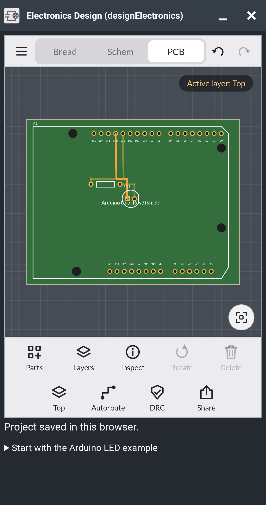
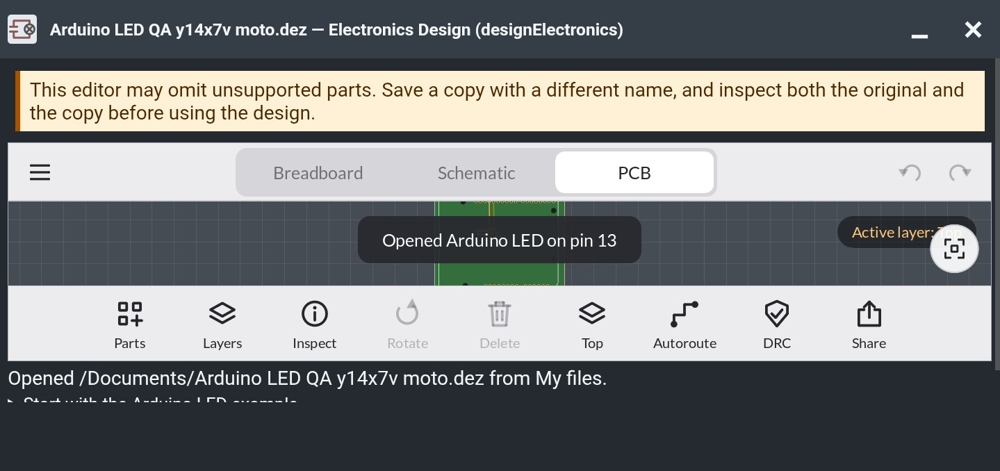

# Electronics Design in WebOS

Open **Electronics → Electronics Design (designElectronics)**. The built-in example connects Arduino pin 13 to an LED through a resistor. Use **Breadboard**, **Schematic** and **PCB** to inspect the same design. On phones, the editor menu opens from the top left.

| Tested item | Version |
| --- | --- |
| Electronics Design runtime | `1240d817db549235df279814ba81b5fac94af058` |
| WebOS viewer | `c30ba950829b52fc2caf07349857e24f27abdcc7c83380f7cb2a29475338beff` |
| Galaxy S10+ portrait | Chrome 158.0.8127.92 at 411 CSS pixels wide |
| Moto G 5G landscape | Chrome 158.0.8127.42 at 822 × 331 CSS pixels |
| Tablet touch emulation | Chromium at 1024 × 768 CSS pixels |
| Desktop Chromium | 1300 × 850 and 2100 × 850 CSS pixels |

## Route and save the example

1. Switch to **Schematic**, return to **PCB**, and tap **Autoroute**. The editor added three traces. The saved design contains seven parts and ten wires, including those traces.
2. Choose **File → Save**. The first save suggests `/Documents/Circuit.dez`. Canceling leaves the design open. Enter a bare name to add `.dez` automatically.
3. In a signed-in session, the status reports when the file is saved to this device and when it has synced to My files. Wait for sync before switching browsers. Exact uploads in the isolated account tests took about 1.5 to 82 seconds after the local save.
4. Close the editor and reopen the editable file from My files. Both phones and desktop passed this step as guests. The isolated signed-in tests reopened the same parts and wires from fresh sessions. Use **Save As** to edit a copy of an opened design.

Phone qualification covered four of ten workflows. It covered the example views, autoroute, the named save and cancellation, and reopening from Files. Desktop covered eight of ten workflows. It added simulated Arduino LED run and stop, the design-rule check, three views with single-view fallback, and protecting the opened original while saving and updating a copy. Native fabrication export and custom part imports remain for later qualification. The simulated LED changed between two visual states and became steady after Stop.

The wrapper now keeps the editor and footer accessible. The landscape canvas is still short, and the lowest rows in some native canvas menus can clip. The tested File commands fit. After opening a saved project in landscape, scroll the wrapper to reach the lesson below the source warning. On the emulated tablet, the Arduino lesson opened and closed by touch. Three views are available in a sufficiently wide and tall window.

## Build and release

The WebOS viewer bundles `index.mjs` and `style.css` with esbuild. It retained the verified designElectronics JavaScript, WebAssembly, and data assets. The build pins and corresponding licenses are listed in the [app README](../../README.md).

The hosted guest workflow passed on both phones and desktop. All 24 changed paths matched over HTTPS. On box-webhost, use `sudo python3 -I -B /var/backups/webos-electronics-design-phone-c30ba950829b/deploy-viewer.py rollback` to restore viewer `51ee63af95a5`.

## Screenshots

